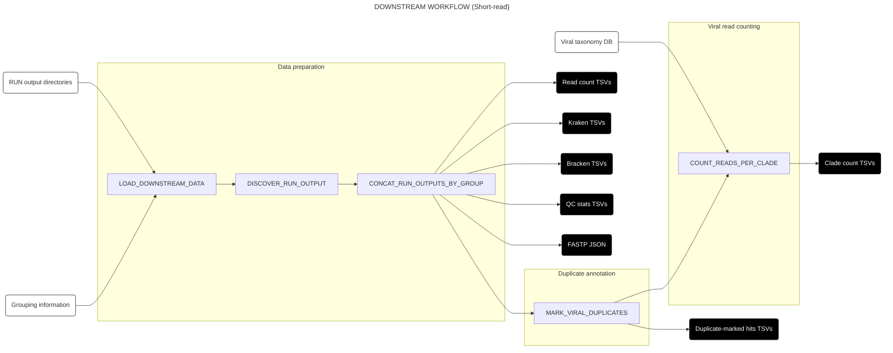
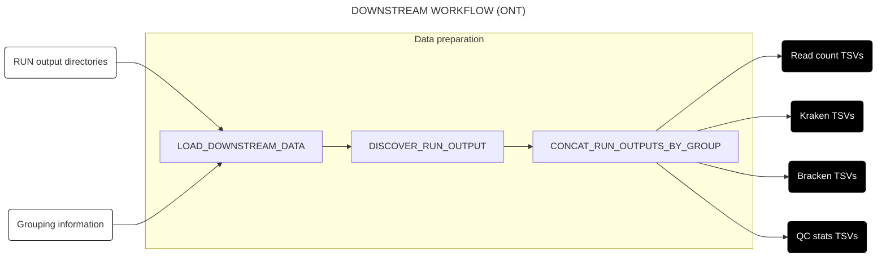
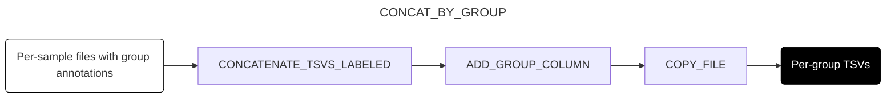
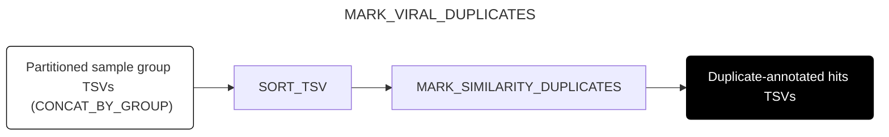

# DOWNSTREAM WORKFLOW

This page describes the structure and function of the `DOWNSTREAM` workflow. This workflow is responsible for downstream analysis of the outputs of the [`RUN` workflow](./run.md), particularly in cases that require comparisons across reads and/or samples[^comp].

For short-read data, this workflow performs two main analyses: (1) identification and marking of duplicate reads by sequence similarity, and (2) counting the number of reads assigned to viral clades by LCA. Viral taxonomic assignments are not validated with BLAST: the `VALIDATE_VIRAL_ASSIGNMENTS` subworkflow remains in the repository, but DOWNSTREAM doesn't call it, so no `validation_hits` are produced. The duplicate-marked hits, which `validation_hits` used to carry, are published as `{group}_duplicate_marked_hits.tsv.gz`, with the columns of `validation_hits` other than `selected_taxid` and the `validation_*` columns.

For ONT data, the workflow only concatenates the per-sample RUN outputs by group. It publishes no per-read viral hits table (upstream, `validation_hits` was ONT's only one); use the RUN workflow's per-sample `virus_hits` instead.

For detailed column-level documentation of DOWNSTREAM output files, see the [schema files](../schemas/) — each schema includes field names, types, descriptions, and examples.

[^comp]: These are kept to a minimum in the `RUN` workflow to minimize memory demands and maximize parallelization.

## Workflow structure

### Short-read (Illumina/Aviti)



### Long-read (ONT)



## Subworkflows

### Load data into channels (`LOAD_DOWNSTREAM_DATA`)

This subworkflow takes in an input file specifying (1) paths to one or more RUN results directories, and (2) paths to corresponding TSV files specifying the sample groupings to be used for duplicate annotation (see [below](#usage) for more information on this input file). The subworkflow validates that this input file has the required structure, resolves run results directory paths, and parses grouping TSVs into sample-group tuples. It emits `run_dirs` (unique resolved directory paths per label) and `groups` (label, sample, group tuples) for use by `DISCOVER_RUN_OUTPUT`. (No diagram is provided for this subworkflow.)

### Discover per-sample output files (`DISCOVER_RUN_OUTPUT`)

This is a reusable subworkflow that discovers all per-sample TSV and JSON files from the RUN output directories and matches them to sample groups. It takes `run_dirs` and `groups` from `LOAD_DOWNSTREAM_DATA`, reads the list of expected per-sample output suffixes from `pyproject.toml`, and for each sample and suffix constructs the expected file path and checks for its existence (trying both gzipped and plain variants). It then validates that all expected per-sample output files are present, failing with an informative error if any are missing (e.g. due to incomplete S3 copies). The output is a channel of tuples `(label, sample, file, group)` containing all discovered files. (No diagram is provided for this subworkflow.)

### Concatenate all per-sample RUN outputs by group (`CONCAT_RUN_OUTPUTS_BY_GROUP`)

This subworkflow wraps multiple calls to `CONCAT_BY_GROUP` (see below) to concatenate all per-sample RUN output types (viral hits, read counts, Kraken reports, Bracken abundance estimates, and QC statistics) into per-group TSVs, and calls `CONCAT_JSON_BY_GROUP` to merge per-sample FASTP JSON files into per-group JSON outputs. It emits three output channels: `hits` (used by downstream duplicate marking and clade counting for short-read data, and unused for ONT), `fastp_json` (per-group combined FASTP QC data, short-read only), and `other` (all remaining TSV outputs, which flow directly to the published results).


### Concatenate per-sample outputs into per-group TSVs (`CONCAT_BY_GROUP`)

This is a general-purpose subworkflow that takes per-sample file tuples (with group annotations), filters for files matching a specified suffix, groups them by sample group, concatenates the files within each group, adds a group column, and renames the output to a clean filename. It is called by `CONCAT_RUN_OUTPUTS_BY_GROUP` for each RUN output type (viral hits, read counts, Kraken reports, Bracken abundance estimates, and QC statistics).



### Annotate duplicates (`MARK_VIRAL_DUPLICATES`)

> [!NOTE]
> This subworkflow is only executed for short-read platforms. ONT processing skips this step.

This subworkflow takes in partitioned hits tables from `CONCAT_BY_GROUP`, sorts each by read ID, and marks duplicates by sequence similarity among all reads, using minimizer-based clustering via the [nao-dedup](https://github.com/securebio/nao-dedup) library (`MARK_SIMILARITY_DUPLICATES`). Reads are processed in read-ID order. Each read is compared with the founding read of each existing cluster that shares a minimizer with it, and joins the first cluster it matches; a read that matches none founds a new cluster. Once all reads are processed, each cluster's exemplar is its highest-scoring member (by mean base quality, then length; ties go to the earlier read), which need not be the read that founded it. Two read pairs match if both mates match, in either mate orientation, with an offset of up to 1 nt and at most `floor(params.sim_dup_max_error_frac × overlap)` mismatches over each mate's overlap, where an offset also spends one mismatch of that budget. An offset shrinks the overlap too, so it can cost two: with the default of 0.02, a 150 bp mate allows 3 mismatches without an offset but only 1 with a 1 nt offset (overlap 149, budget 2), and a mate of 50–99 bp allows 1 mismatch without an offset, while a 50 bp mate can't match at an offset at all. At nao-dedup's own default of 0.01, a 150 bp mate allows 1 mismatch, so copies of a molecule with two or more sequencing errors in a mate are split off as distinct.

Read IDs must be unique within a group; a repeated ID stops the task with an error. The subworkflow adds `sim_dup_exemplar` (the exemplar of the read's cluster[^exemplar]) and `sim_dup_group_size` (the number of reads in the cluster, given on the exemplar's row only). It also adds `prim_align_dup_exemplar`, set to each read's own ID, so the columns match those of earlier versions. The result is published as `{group}_duplicate_marked_hits.tsv.gz` (schema: `schemas/duplicate_marked_hits.schema.json`), and is the table `COUNT_READS_PER_CLADE` counts from.

Duplicates are not marked by alignment coordinates. Earlier versions first grouped reads whose mates had the same Bowtie2 5′ coordinates (within 1 nt) and marked similarity duplicates only among the reads that survived. That pass merged distinct molecules that happened to share coordinates, and its grouping is quadratic in the depth of a stack of reads at identical coordinates, which could keep a group with millions of hits on one short genome from finishing.

[^exemplar]: A read with no duplicates will be annotated with itself as the exemplar.



#### Read assignments after duplicate marking

Once duplicates are marked, each read can be thought of as having two assignments:

- The read's own aligner LCA, in `aligner_taxid_lca`, or
- The aligner LCA of the exemplar representing it.

Generally these two taxids agree. However, similarity-based marking keys on the read sequence itself, which is not directly tied to `aligner_taxid_lca`, which is derived from all of a read's alignments. A duplicate group can therefore span multiple `aligner_taxid_lca` values.

### Viral read counting


> [!NOTE]
> This subworkflow is only executed for short-read platforms. ONT processing skips this step.


For each sample group, this module counts the number of reads assigned by LCA to each viral taxon in two ways:

1. The number of reads directly assigned to a taxid by LCA.
2. The number of reads assigned to any taxid in the clade descended from a taxid by LCA.

It takes as input:

- Annotated hits TSVs from `MARK_VIRAL_DUPLICATES`
- The viral taxonomy database (`total-virus-db-annotated.tsv.gz`) generated by the [`INDEX` workflow](./index.md).

It outputs a TSV for each sample group (`<group>_clade_counts.tsv.gz`) with nine columns:

1. `group`: the sample group these counts are for
2. `taxid`: the taxid for the row
3. `parent_taxid`: the taxid of the row taxid's phylogenetic parent
4. `reads_direct_total`: the number of reads directly assigned to the taxid without deduplication
5. `reads_direct_dedup`: the number of reads directly assigned with deduplication, which excludes similarity duplicates (`seq_id == sim_dup_exemplar`)
6. `reads_direct_total_by_exemplar`: as `reads_direct_total`, but counting each read under the taxid of the exemplar representing it rather than its own
7. `reads_clade_total`: the number of reads assigned to the clade descended from the taxid (including the directly assigned reads) without deduplication
8. `reads_clade_dedup`: the number of reads assigned to the clade with deduplication
9. `reads_clade_total_by_exemplar`: as `reads_clade_total`, but counting each read under the taxid of the exemplar representing it

The `total` columns count each read under its own aligner LCA; the `total_by_exemplar` columns count it under the LCA of the exemplar representing it (see [Read assignments after duplicate marking](#read-assignments-after-duplicate-marking)). The two therefore differ only where a duplicate group's members were assigned different taxa. The `total_by_exemplar` columns exist so that `dedup / total_by_exemplar` is a per-taxid duplication rate over one coherent set of reads, which `dedup / total` is not.

## Usage

> [!IMPORTANT]
> As with the [`RUN` workflow](./usage.md), before following the instructions in this section, make sure you have followed the [installation and setup instructions](./installation.md).

To run the `DOWNSTREAM` workflow, you need:

1. One or more accessible **RUN results directories** produced by the `RUN` workflow, containing per-sample viral hits files (e.g. `*_virus_hits.tsv.gz`). These are [typically saved](./output.md#viral-identification) in the `RUN` workflow's output directory under `results/`.
2. For each RUN results directory, an accessible **grouping TSV**, containing the following columns in the specified order:
    - `sample`: Sample ID (must include one row for every value of this column in the viral hits table)
    - `group`: Group IDs to use for grouping samples in downstream analysis
3. An accessible **input file CSV** mapping RUN results directories to grouping TSVs, containing the following columns in the specified order:
    - `label`: Arbitrary string label to use for each RUN results directory
    - `run_results_dir`: Path to the RUN results directory containing per-sample viral hits files
    - `groups_tsv`: Path to the corresponding grouping TSV

> [!NOTE]
> Paths in the input file can be absolute paths, S3 URIs (e.g., `s3://bucket/path/to/file.tsv`), or **relative paths**. Relative paths are resolved against `params.input_base_dir`, which defaults to the pipeline directory (`projectDir`). To resolve relative paths against your launch directory instead, set `params.input_base_dir = launchDir` in your config file.

4. A **reference directory** containing the databases and indices generated by the [`INDEX` workflow](./index.md), including[^ref_dir]:
    - The viral taxonomy database (`total-virus-db-annotated.tsv.gz`)
5. A **config file** in a clean launch directory, pointing to:
    - The sequencing platform (`params.platform`); one of: "illumina", "aviti", "pacbio", "ont"
    - The pipeline mode (`params.mode = "downstream"`);
    - The input file (`params.input_file`);
    - The base directory in which to put the working and output directories (`params.base_dir`);
    - The reference directory containing databases and indices (`params.ref_dir`);
    - The mismatch budget for similarity duplicate marking, as a fraction of each mate's overlap (`params.sim_dup_max_error_frac`, default 0.02); **Note: Only used for short-read platforms**

> [!NOTE]
> Currently, the input file and grouping TSV must be generated manually. We intend to implement programmatic generation of these files in the future.

> [!TIP]
> We recommend starting each pipeline run in a clean launch directory, containing only your input file and config file.

> [!TIP]
> For ONT data, use `configs/downstream_ont.config` as your starting template.


Given these input files, you must choose a run profile as described [here](./usage.md#2-choosing-a-profile). You can then run the pipeline as follows:

```
nextflow run -resume -profile <PROFILE> <PATH/TO/PIPELINE/DIR>
```

where `<PATH/TO/PIPELINE/DIR>` specifies the path to the directory containing the pipeline files from this repository (in particular, `main.nf`) from the launch directory.

Once the pipeline has finished, output and logging files will be available in the `output` subdirectory of the base directory specified in the config file.

> [!IMPORTANT]
> As with the `RUN` workflow, it's highly recommended to clean up your Nextflow working directory after run completion. You can do this manually or with the `nextflow clean` command.

[^ref_dir]: This can be the same reference directory used by the `RUN` workflow - you do not need to run the `INDEX` workflow separately for the `DOWNSTREAM` workflow.
